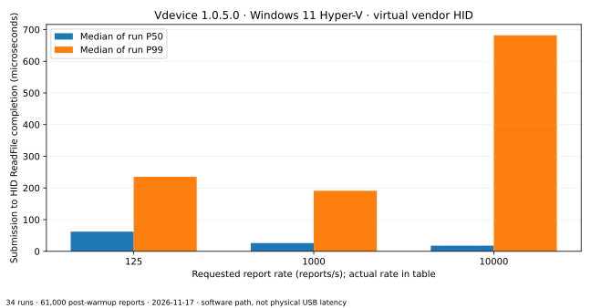

TitanCSA · Windows driver laboratory

# Measure the path. Keep the evidence.

Reproducible input measurements, independent Windows receivers, and the raw data behind every chart.

[Explore measured results](vdevice/latency.md){ .md-button .md-button--primary }
[Read the methodology](methodology/measurement.md){ .md-button }

<strong>36</strong>validated vendor-HID runs

<strong>99,500</strong>post-warmup vendor-HID reports

<strong>2 vCPU</strong>Windows 11 · Hyper-V · 3 GiB fixed RAM

!!! note "Vdevice teardown fix status"
    Microsoft-signed Vdevice demo 1.0.6.0 passed separate controller teardown tests. Signed Demo 1.0.6.1 and Release 1.0.4.1 include the fix. The [installation evidence](https://titancsa.github.io/assets/vdevice-signed-versions-2026-11-25.json) records the exact archives, signatures and tested paths. The [incident record](methodology/incident-wdf-001.md) retains the original 1.0.5.0 crashes and describes the fix validation.

## Start with the question you need answered

| Question | Evidence |
|---|---|
| How long until a virtual HID report reaches an application? | [Vendor HID submission to Windows ReadFile](vdevice/latency.md) |
| How do Vdevice and ViGEmBus expose Xbox 360 states? | [Closed-loop XInput comparison](vdevice/comparisons.md) |
| Does the requested rate match delivered traffic? | [Submission cadence, queues and losses](vdevice/throughput.md) |
| Which driver fits interception, hiding or virtual-device creation? | [Source-backed project audit](comparisons/index.md) |
| Can I reproduce the result? | [Raw data](data.md), [environment](methodology/environment.md), [automation](methodology/reproducibility.md) |

**Read the boundary before the number.** These are virtual-device software-path measurements on one Windows 11 guest. They do not measure physical USB latency, prove compatibility with every controller, or establish that TitanCSA is universally faster. This laboratory is operated by TitanCSA, a developer of the tested products.

## Results you can inspect

The C++ producer records submission timestamps. A separate executable receives and validates content using Windows HID, Raw Input or XInput. Reports preserve sequence IDs, timing, seeds, configuration, failed runs and provenance. Tables and charts are generated from validated data rather than typed into pages.

## Projects covered by the audit

[Interceptor](interceptor/overview.md), [Interceptor Keyboard & Mouse](interceptor/overview.md), [Interceptor Gamepad & Controller](gamepad/overview.md), [Vdevice](vdevice/overview.md), and [Interception V2](interceptor/comparisons.md). The comparison inventory also covers oblitum/Interception, ViGEmBus, HidHide, vJoy, libvirtualhid and Microsoft samples. Source review and runtime measurements have distinct statuses.

