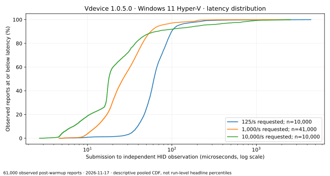
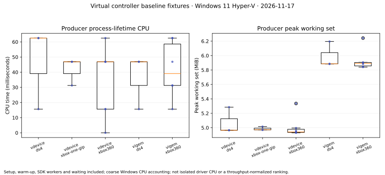

# Distributions and resource diagnostics

## Vendor HID latency distribution

This descriptive CDF pools independently observed post-warmup reports at each requested submission rate. It retains measured tails and excludes stability/instrumented trials. Run-level medians and bootstrap intervals remain the headline statistics on the [latency page](../vdevice/latency.md). Unmatched reports are counted there and in the raw results; a received-report CDF does not depict missing reports.

## Controller producer CPU and memory

Points are individual validated baseline runs; boxes describe their distribution. CPU is process-lifetime user plus kernel accounting in milliseconds, including initialization, warm-up and SDK threads. Peak working set is process pages, not driver pool usage. Different profile stacks and polling schedules prevent a universal CPU-efficiency ranking. Zero at coarse accounting resolution does not mean zero work.

| Backend/profile | Runs | Median producer CPU (ms) | Median peak working set (MiB) |
|---|---:|---:|---:|
| vdevice/ds4 | 3 | 62.500 | 4.965 |
| vdevice/xbox-one-gip | 3 | 46.875 | 4.973 |
| vdevice/xbox360 | 7 | 46.875 | 4.941 |
| vigem/ds4 | 3 | 46.875 | 5.887 |
| vigem/xbox360 | 6 | 39.062 | 5.891 |

These figures do not establish device enumeration latency or a memory-leak verdict. Dedicated enumeration timing and multi-hour leak qualification remain additional work. See the [five-minute memory observation](stability.md), [separate WPR/DPC trial](etw.md) and [open stability incident](incident-wdf-001.md).

[Raw measurements](../assets/raw-results.zip) · [Per-run resource counters](../assets/xinput-results.json). All charts are regenerated by `scripts/diagnostic_charts.py` from validated records.
