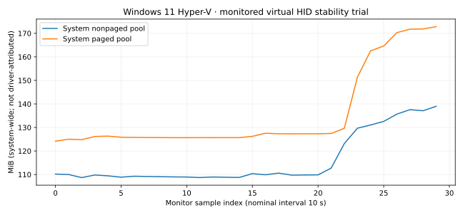

# Five-minute monitored HID trial

The dedicated VM ran a 125 reports/s vendor-HID scenario for 37,500 measured reports plus 100 warm-up reports. Independent Windows HID reception and the standard sequence/checksum validator qualify the CSV. This series is tagged `purpose=stability` and is excluded from primary latency charts because a PowerShell memory sampler intentionally runs alongside it.

| Observation | Recorded result |
|---|---|
| Memory samples | 30 |
| Owned native processes after cleanup | 0 |
| Present vendor-HID test nodes after cleanup | 0 |
| Nonpaged pool range, system-wide | 108.69–139.00 MiB |

## What this does and does not show

This is one five-minute exposure, not a multi-hour soak, fault-injection qualification or proof of no memory leaks. Pool counters cover all guest drivers, Windows background work and the sampler. They cannot attribute allocations or deallocations to Vdevice alone.

The wall-clock-derived WMI boot timestamp changed between the initial post-checkpoint snapshot and the final observation. That field is therefore not used as a reliable restart detector. The native workload's continuous completed QPC/sequence record is the timing evidence; no latency is computed from host/guest or unsynchronized wall clocks.

The standalone vendor-HID run and the [WDF-001 teardown tests](incident-wdf-001.md) cover different scenarios. The signed 1.0.6.0 demo passed separate controller teardown tests. [Vdevice Release 1.0.4.1 qualification](https://titancsa.github.io/assets/vdevice-signed-versions-2026-11-25.json) covers signed installation, upgrade and readiness before activation. Longer-duration testing remains pending.

[Raw CSV/JSON](../assets/raw-results.zip) · [Per-run qualification](../assets/results.json) · [Environment](environment.md)
