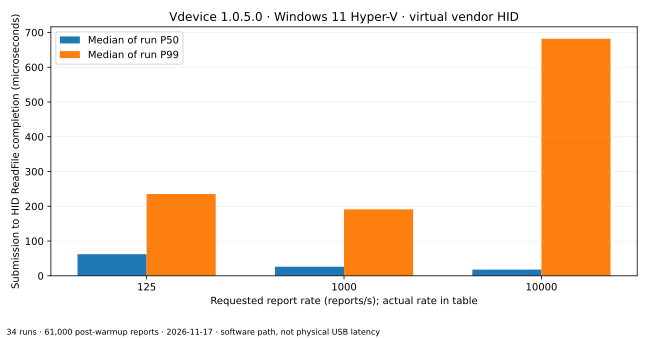

# Virtual HID input latency

These are real software-path measurements in a dedicated Windows 11 Hyper-V VM. The producer calls Vdevice `Send_Input`; a separate process receives the vendor-defined report through Windows `ReadFile`. Each report carries a sequence, same-guest QPC timestamp, seed and checksum. No physical USB latency or competitor superiority is claimed.

| Requested reports/s | Runs | Received reports | Median run P50 (µs) | Median run P99 (µs) | Observed submissions/s | Missing |
|---:|---:|---:|---:|---:|---:|---:|
| 125 | 10 | 10000 | 62.08 | 235.39 | 125.0 | 0 |
| 1000 | 14 | 41000 | 26.12 | 191.30 | 1000.0 | 0 |
| 10000 | 10 | 10000 | 17.92 | 682.00 | 10004.1 | 0 |

P50/P99 above are medians of per-run percentiles, not pooled percentiles. Warm-up is 100 reports per run. Requested frequency is a scheduling target; observed submissions are measured. All tails remain in the results. Repeats use fresh processes and device creation in the same VM, not independent hosts. Bootstrap intervals in the aggregate JSON describe between-run medians only; small samples and shared host conditions limit generalization.

## Scope and limitations

- This vendor-defined HID profile is not a keyboard, mouse or Xbox controller profile.
- It does not traverse an Interceptor filter. This page makes no interception-overhead claim.
- Latency includes producer work after the timestamp, Windows virtual USB/HID processing, queuing and receiver scheduling. It is not isolated kernel execution time.
- Windows HID buffering was set to 512 reports. Report length is 32 bytes; USB interrupt descriptor interval is 1 ms at full speed. A higher submission rate does not mean a higher USB polling frequency.
- Process CPU/memory counters cover the process lifetime, including enumeration and waiting; zero CPU counters at coarse Windows accounting resolution do not mean zero CPU cost.
- HVCI is disabled in the guest; Secure Boot is on. Other host workloads were not suspended.
- Pilot runs and failed runs remain in the archive. The results JSON identifies invalid runs and their reasons. No valid measured run is discarded for an unfavorable tail.

## Download and reproduce

[Raw CSV/JSON archive](../assets/raw-results.zip) · [Per-run statistics](../assets/results.json) · [Aggregate statistics](../assets/aggregates.json) · [Environment](../methodology/environment.md) · [Reproduction](../methodology/reproducibility.md)

